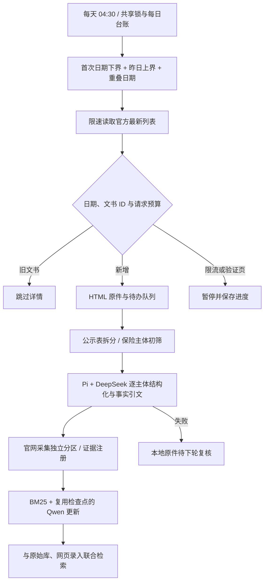

# 官网增量案例接入与测试记录

本地实现日期：2026-10-19。参考仓库：
[wzz356/finrisk-agentic-rag](https://github.com/wzz356/finrisk-agentic-rag/tree/3c2b89c01db3eac7ad60a0b9b37f7050077f79ff)。
该版本实际运行的采集链使用 NFRA；本项目接入相同的三个官方处罚栏目，采集、调度和分区逻辑按当前项目接口实现。

## 运行链



首次部署不访问历史详情。空起始日期由第一次启用固定为当天，重启不变；默认次日凌晨处理当天的案例。
每个栏目单独记录成功水位；未知日期、列表变化、页数不足及处理失败均不会伪装为完整更新。
达到详情预算的文书 ID 进入持久化待办；次日即使它已移出第一页，仍能按 ID 续采。
模型失败保留原件；分区多文件写入中断后依提交标记恢复，避免半行 JSON 影响启动。

默认官网请求间隔 3–5 秒，单轮最多 32 次请求、每栏目最多 3 页、共 12 份详情。
检查 robots.txt，条件请求复用缓存，403/429、验证码和 Retry-After 会停止继续访问。
不使用验证码绕过、代理轮换或账号轮换。采集原件中的文字作为数据处理，不当作项目指令执行。

## 三种来源

| 来源 | 写入位置 | 页面筛选值 |
|---|---|---|
| 原始知识库 | `data/processed/knowledge/finrisk_v2_1_20261018/` | `original` |
| 官网采集 | `data/processed/case_sources/official_crawl/` | `official_crawl` |
| 网页录入 | `data/processed/case_sources/web_ingestion/` | `web_ingestion` |

两个新增分区分别保存三份 JSONL、证据 SQLite 及 manifest；原件、HTML 快照、来源 URL 和发布日期保留。
新增入库、停用和联合检索不改写原始案例、原始证据库或原始 manifest。
查询端联合读取三个分区，Pi 证据工具能够读取新增案例的逐字原文及 SHA256。
Qwen 文档和查询仍使用同一模型、维度及服务端点；新增文本复用现有 SQLite 向量检查点，未重新编码全量文档。

## 首次官网链路验证

真实官网访问只用了 3 次请求：robots、最新列表、当天最新详情。随后复用原件进行真实模型调用及重复运行测试。
文书为[大连监管局 2026 年 87 号公开表](https://www.nfra.gov.cn/cn/view/pages/ItemDetail.html?docId=1275042&itemId=4114&generaltype=9)，发布日期为 2026-10-19。

| 项目 | 本轮结果 |
|---|---|
| 真实结构化 | Pi 调用 DeepSeek，生成 1 个保险处罚主体案例 |
| Qwen 向量 | 1024 维；7 个检索单元，5 段不同文本，1 次文档向量请求 |
| 隔离测试入库及索引刷新 | 约 5.60 秒；不含之前的官网下载时间 |
| 检索连通 | 查询命中新案例，稠密通道参与匹配 |
| 证据回源 | 新分区证据能够通过联合读取与逐字校验 |
| 再次运行 | 新增案例 0、重复下载 0 |
| 失败恢复 | 先遇 Qwen 连接超时，保留案例；修复系统代理读取后从索引阶段续跑成功 |
| 后端回归 | 204 项通过 |
| Pi 与前端单元测试 | 31 项通过 |
| 静态检查 | Ruff 和严格 Mypy 均通过 |

这是单份近期官方文书的链路验证，不作为新的风险分类准确率或召回率结果。测试刻意只读取一页，
未把这一受限窗口标记为全栏目扫描成功。完整机器记录在
[`reports/collection/latest_smoke.json`](../reports/collection/latest_smoke.json)。

本轮同时修复云检索 HTTP 客户端未读取 Windows 系统代理导致的连接超时；可用
`FINRISK_CLOUD_PROXY` 显式设置代理或设为 `direct`。官网采集不轮换代理。

首次验证将同一份今日官网文书通过真实入库链加入本地官网分区，当时为原始 9,639 份、官网采集 1 份、网页录入 0 份。
本地合并索引更新中，116,321 个检索单元复用了向量，只有 4 段不同文本调用 Qwen 编码，1 次文档向量请求。
合并索引在本地生成约 19.50 秒；这属于离线更新耗时，不是在线 Query 延时。
原始 `cases`、`chunks`、`expansions`、证据注册库与 manifest 共 5 个文件的 SHA256 均保持不变。
本地已固定起始日期 2026-10-19，下次自动运行时间为 2026-10-20 04:30。

## 现有采集文件补录

已核对上游 [knowledge-v2-20261019 发布包](https://github.com/wzz356/finrisk-agentic-rag/releases/tag/knowledge-v2-20261019)。
其 manifest 明确记载 `new_856_included=false`；这批 856 份待审材料没有进入该公开包。
公开包中的 15,620 张已有案例卡按 ID 跳过，另 1 份长治监管分局处罚案例写入官网采集分区。
发布包 SHA256 与上游清单一致，字段、标签依据和证据偏移均与原文逐字校验。

同时复用此前用户提供的 `FinRisk_risk整合交付_20261018.zip` 中已采集的 765 份原文及其台账：

| 处理结果 | 文书数 |
|---|---:|
| 新增保险相关材料 | 364 |
| 与公开包新增案例重复 | 1 |
| 非保险业务材料 | 400 |

这 364 份中，284 份存在可复用的历史结构化记录，80 份通过本地表格字段解析与事实规则整理。
旧标签仅保留在原文违法事实中能定位到逐字引文的部分。公告送达材料补充姓名、违法事实、行业禁入处罚和日期解析。
多主体公示表保留主体组合和完整处罚内容，标记 `grouped_notice_preserved`，不把合计罚款虚构分摊给个人。
所有记录保留官网 URL、文书 ID、栏目、发布日期、源文件指纹、归档成员路径和导入来源。

本次合计新增 **365 份**，加上此前验证的 1 份，官网采集分区现为 **366 份**。
原始库仍为 **9,639 份文书 / 15,620 张案例卡**，网页录入为 **0 份**；联合读取为 **10,005 份文书 / 15,986 张案例卡**。
历史文件补录不改变每日采集的起始日期、水位或已排定时间，也不向官网重新发请求。

两个导入入口默认只输出核对计划，显式 `--apply` 才入库：

```powershell
.venv/Scripts/python scripts/import_collected_release.py --archive <发布包.zip> --sha256 <上游SHA256> --apply --no-refresh-index
.venv/Scripts/python scripts/import_collected_archive.py --archive <原交付压缩包.zip> --apply
```

发布包走 `prestructured_release`，交付包走 `legacy_structured` / `collected_fields`；两个入口均不创建聊天模型客户端。
批量写入在一个事务中按文件绑定全文、证据区间和 SHA256，最后只刷新一次索引，重跑按内容指纹和文号主体跳过重复。
导入详情见 `reports/collection/repository_import.json`、`archived_collection_import.json` 和 `archived_collection_repair.json`；
联合索引、回源和检索验证见 `collected_import_verification.json`。

补录后的索引共 117,158 个检索单元、51,882 段不同文本，复用 51,647 段已有向量，仅对缺失的 235 段文本发起
12 个 Qwen 文档向量批次。矩阵重建耗时约 21.55 秒，维度仍为 1,024；加载完成后不再次调用文档编码。
官网分区 1,202 个已登记证据单元均通过全文 SHA256、区间及逐字引文检查，Pi 证据工具抽查通过。
原始库 5 个核心文件 SHA256 不变，每日采集台账不变。

补录回归为 224 项 Python 测试、31 项 Pi / 前端测试通过，Ruff 和严格 Mypy（82 个源文件）通过。
浏览器验证三种来源数量、筛选、官网 TXT 原件和原始 PDF 下载正常，无脚本错误或横向溢出。
另以恒邦长治、张洪刚公告和天安潮州三种材料核对真实向量参与及机构条件检索；通用的“业务财务数据不真实”
事实在全库存在大量同文案例，天安潮州样例未进入无条件前十，结合处罚主体筛选后可找到对应公示表。
该记录保留在验证报告中，不把主体条件连通测试表述为无条件召回率提升。

## Qwen 历史调用量

`scripts/build_aligned_qrels.py` 是此前对齐效果测试集的离线标注脚本，未接入 Web 请求或每日采集调度。
它对 60 条开发 Query、200 条测试 Query 各标注 500 个候选案例，每批 50 个候选，基础规模为 2,600 批，
之后还有漏项补标和证据修正。已有日志记录 Qwen3.7-Flash 成功逻辑任务 2,888 条，输入 39,056,303、
输出 1,949,894、合计 41,006,197 tokens。这是本地保存的成功任务口径，不等同于供应商最终账单或全部底层重试请求。
完整分模型汇总见 `reports/collection/model_usage_audit_20261019.json`。

本次文件补录聊天 API 调用为 0、官网 HTTP 请求为 0；Qwen 只承担缺失文本的向量编码。
在线主判断和默认重排仍走 DeepSeek / Pi，向量模型仍是 `qwen3.7-text-embedding`，可选云重排为 `qwen3-rerank`。

## 部署后保留

`.env.example` 和 systemd 服务文件已启用每日采集。项目服务运行时调度生效，源码安装到新目录后会在
第一次运行建立自己的起始日期。迁移已有部署时，保留 `data/raw/cases/official_crawl/` 的台账、
`data/processed/case_sources/` 的新增记录和证据，以及完整 `data/cache/dense/` 向量检查点。
`GET /api/collection/status` 与案例管理页显示下次运行时间和进度。

本轮只在本地修改与验证，没有推送 GitHub，也没有改动服务器。
